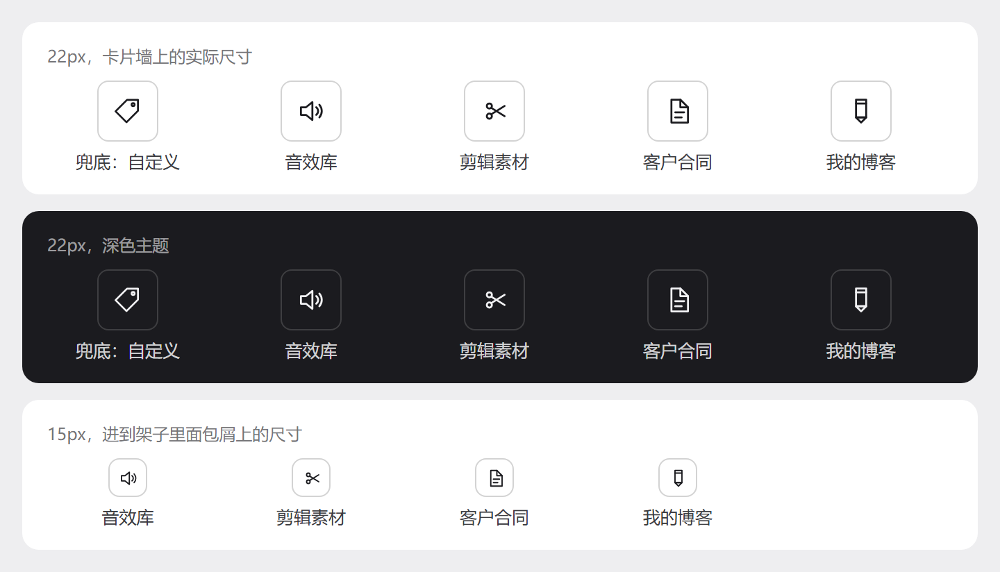

# dsh-skill-manager

一个给 [DeepSeek Harness](https://github.com/deepseek-ai/DeepSeek-Harness) 用的技能管理面板，帮你把本机上装的所有技能看清楚、管好。

版本 0.3.0，MIT 开源，作者 HighToward。

- 界面语言：简体中文 / English（跟随 DSH）
- 运行位置：DSH Web GUI 左侧边栏
- 零依赖，纯 ESM + React（由宿主注入）

## 它长什么样




## 功能

**扫描全部技能**
自动读取工作区和用户目录下的 `.dsh/skills`、`.agents/skills`，以及 WorkBuddy 留下的 `parked-skills` 和 `library`（未启用的也会列出来）。同名技能按来源优先级去重，重复的会告诉你。

**按类型整理**
内置 15 个类型：剪辑与视频、声音与音乐、设计与图片、文档与表格、写作与文案、浏览器与桌面、检索与调研、开发与部署、数据与地图、安全审查、求职与招聘、技能管理、消息与邮件、本机杂项、其他。已启用和未启用的技能都会分类，未启用的带一枚小徽章。

**自建类型**
卡片墙末尾有一格虚线的「新建类型」，起个名字就能建。点进一个技能，右侧抽屉里有「归属类型」下拉，可以把技能挪到任意自建类型，也可以选「自动分类」让它回到关键词判定的位置。删掉一个自建类型时，里面的技能会退回自动分类，不会凭空消失。

**让模型写中文说明**
工具栏上有「让模型写说明」，旁边是模型下拉，列出 DSH 当前配置的所有 provider 和模型，你选哪个就用哪个。模型给每个技能写一句 18 到 34 字的中文，英文答复会被判为不合格并重问一次。说明按 SKILL.md 的内容哈希缓存，文件没变就不重写。

**给自建类型画图标**
新建类型后自动画一次，用的就是说明模型。图标是 24×24 网格上的描边图形，模型只返回 JSON 形状数组，标签和属性都过白名单。没画成时显示一枚「自定义」标签图标。面包屑上有「生成图标 / 重画图标」，随时可以再画。

**技能关联**
技能之间的关联看三类信号：正文里有没有点名另一个技能、是不是同一个类型、是不是同一个分类。详情抽屉里把关联的技能列出来，并且标出为什么关联。

**检查更新**
对带安装元数据的技能，批量查 SkillHub 的接口比对版本，没元数据的再试着读 GitHub raw。

**详情抽屉**
点任意一行或一张卡片，右侧抽屉显示来源、路径、版本、哈希、文件大小、修改时间，以及 SKILL.md 原文。

## 安装

要求 Node 20 以上，DSH Web GUI 在运行。

```bash
git clone https://github.com/HighToward/dsh-skill-manager.git
cd dsh-skill-manager
# 在 profile 的 package.json 里加一条指向本地克隆的 link 依赖，例如：
#   "dsh-skill-manager": "link:/absolute/path/to/dsh-skill-manager"
```

然后在 `plugin_manager` 里把这个 bundle 关掉再打开（enabled false 再 enabled true），两次都返回 applied 就是热重载成功。直接 `install_bundle` 对已装的包会报 already-installed，不会替换运行中的实例。

## 开发与测试

测试脚本在 `tests/`，用 Node 直接跑，不需要装依赖（渲染类脚本用到全局 playwright 和 chromium）。

```bash
node tests/smoke.mjs      # host 半端到端
node tests/load.mjs       # client 能否注册两个 slot
node tests/render.mjs     # 卡片墙、钻取、自建类型、图标回落
node tests/drawer.mjs     # 详情抽屉与归属类型下拉
node tests/cascade.mjs    # brand 按钮 hover 的 CSS 特异性
node tests/types.mjs      # 自建类型 CRUD、分配、图标白名单
```

`tests/live-icon.mjs` 和 `tests/shot-shelf-icons.mjs` 会对运行中的 GUI 发真实请求，用真实模型画图标并截图，跑完会自己清理现场。

## License

MIT。见 [LICENSE](LICENSE)。

---

# English

A skill manager panel for [DeepSeek Harness](https://github.com/deepseek-ai/DeepSeek-Harness). It scans every skill it can find on the machine, lays them out as a wall of type cards, lets you create your own types, move skills into them, have a model write a one-line Simplified Chinese description for each skill, draw an icon for each custom type, see how skills relate, and check whether any of them have a newer version.

Version 0.3.0, MIT licensed, by HighToward.

## What it does

**Scans everything**
Reads workspace and user level `.dsh/skills` and `.agents/skills`, plus WorkBuddy's `parked-skills` and `library` (inactive skills are listed too). Duplicate names are resolved by source precedence and reported.

**Groups by type**
15 built-in types: video, audio, design, office, writing, browser, research, dev, data, security, jobs, skillops, comms, system and other. Both active and inactive skills are classified; inactive ones carry a small badge.

**Custom types**
Create your own types from the dashed "New type" tile, then move any skill onto one from the "Shelf" dropdown in its detail drawer, or pick "Automatic" to send it back. Deleting a custom type returns its skills to automatic classification.

**Model written Chinese descriptions**
The toolbar dropdown lists every provider and model DSH has configured. The model writes one plain Chinese sentence of 18 to 34 characters per skill; English answers are rejected and retried. Descriptions are cached by content hash.

**Draws icons for custom types**
A custom type gets an icon drawn by the description model right after creation. Icons are stroked shapes on a 24 by 24 grid, returned as JSON and validated against a whitelist. A generic tag glyph is shown when no icon has been drawn. The breadcrumb offers "Draw icon" or "Redraw icon".

**Relations**
Built from three signals: whether another skill is named in the body text, whether two skills share a type, and whether they share a category. The drawer lists neighbours and labels the reason.

**Update check**
Queries SkillHub in batches for skills with install metadata and falls back to GitHub raw where possible.

**Detail drawer**
Click any row or card to see source, path, version, hash, size, modified time, and the raw SKILL.md.

## Install

Node 20 or newer, DSH Web GUI running.

```bash
git clone https://github.com/HighToward/dsh-skill-manager.git
cd dsh-skill-manager
# Add a link dependency to your profile's package.json, for example:
#   "dsh-skill-manager": "link:/absolute/path/to/dsh-skill-manager"
```

Then toggle the bundle off and on in `plugin_manager` (both calls should return applied). `install_bundle` reports `already-installed` on an existing link and will not replace the running instance.

## Development and tests

Run the scripts in `tests/` with plain Node. They need no installed dependencies; the rendering ones use a global playwright and chromium.

```bash
node tests/smoke.mjs
node tests/load.mjs
node tests/render.mjs
node tests/drawer.mjs
node tests/cascade.mjs
node tests/types.mjs
```

`tests/live-icon.mjs` and `tests/shot-shelf-icons.mjs` talk to a running GUI with a real model and clean up afterwards.

## License

MIT. See [LICENSE](LICENSE).
